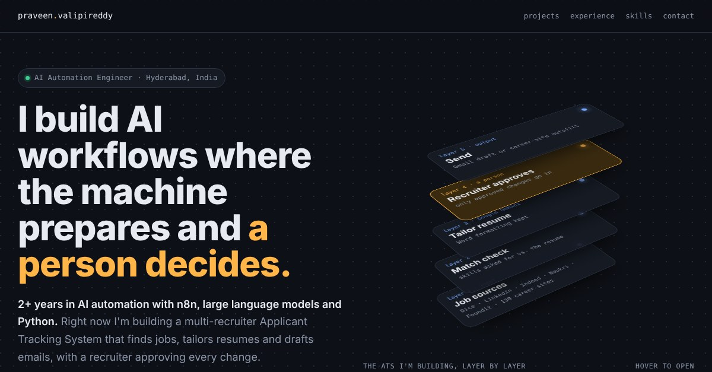
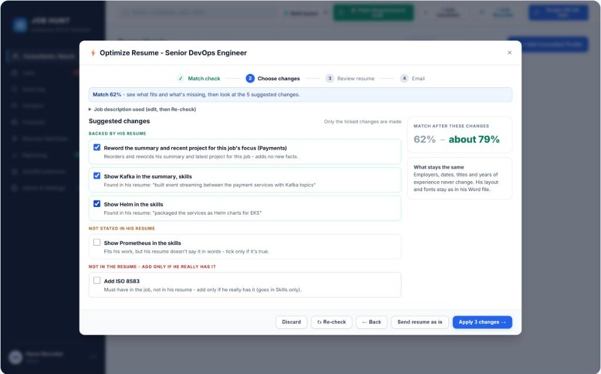
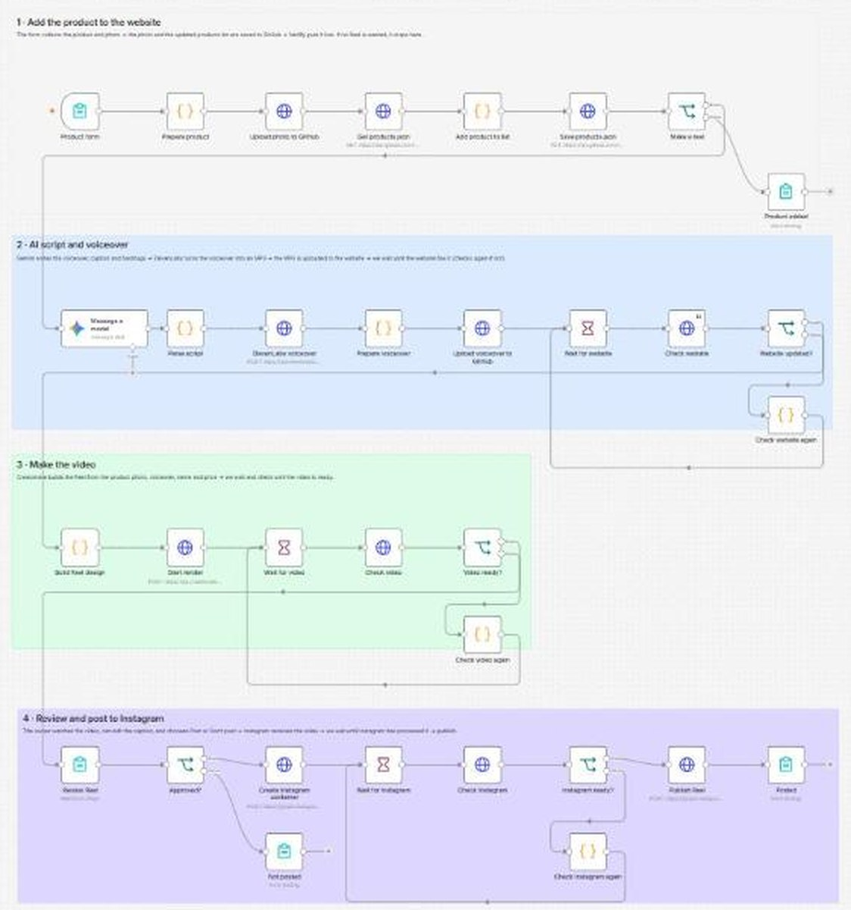

# Praveen Valipireddy, AI Automation Engineer

**Live site: [praveenvalipireddy.netlify.app](https://praveenvalipireddy.netlify.app)**

I build AI workflows where the machine prepares and a person decides. This repo holds my portfolio website.

## Featured projects

### Recruiting ATS that tailors every submission
A live, multi-recruiter Applicant Tracking System for US and India staffing teams, built in Python and Flask.
- One search across Dice, LinkedIn, Indeed, Naukri, Foundit and 130 company career sites
- AI resume tailoring with Google Gemini, with a safeguard so the AI never invents skills
- Gmail drafts and a Chrome extension (Manifest V3) for career-site autofill, with the recruiter approving every change

[Read the project](https://praveenvalipireddy.netlify.app/#project-ats)

### A shop that lists products and makes its own Reels
An n8n workflow (self-hosted on Docker) for a handcrafted bridal business.
- The owner adds a product in one form: n8n updates the website through the GitHub API and Netlify deploys it
- Gemini writes the script, ElevenLabs voices it in Telugu or English, Creatomate renders the Reel
- The owner reviews and approves, then the Instagram Graph API publishes it

[Read the project](https://praveenvalipireddy.netlify.app/#project-shop) · [Live shop](https://kalyanavaibhogam.netlify.app/)

## Tools
n8n · Python · Flask · Google Gemini · Claude · ElevenLabs · Creatomate · Instagram Graph API · GitHub REST API · Docker · Netlify · Render · Supabase (PostgreSQL)

## Contact
- LinkedIn: [linkedin.com/in/valipireddy-praveen-770231196](https://www.linkedin.com/in/valipireddy-praveen-770231196)
- Email: praveen.ai7075@gmail.com

## About this site
A single static page (`index.html` + `img/`), deployed on Netlify. Every push to `main` goes live automatically.
